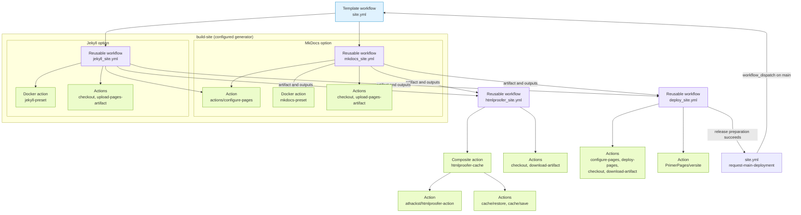

# Site

`site.yml` builds and optionally deploys documentation sites.

## Generated When

Generated when `site_generator` is `mkdocs` or `jekyll`.

Choose `site_generator: none` when an external provider owns the site workflow.

## Runs On

- Pushes to `main`
- Pull requests
- Release `published` events
- Manual requests (`workflow_dispatch`) on `main`

## Calls

For MkDocs:

```yaml
uses: athackst/ci/.github/workflows/mkdocs_site.yml@main
```

See [`mkdocs_site.yml`](../workflows/mkdocs_site.md) for the reusable workflow
contract.

For Jekyll:

```yaml
uses: athackst/ci/.github/workflows/jekyll_site.yml@main
```

See [`jekyll_site.yml`](../workflows/jekyll_site.md) for the reusable workflow
contract.

## Dependencies



## Permissions

- `build-site`: `contents: read`, plus `pages: read` for GitHub Pages location resolution
- `test-site`: `contents: read`
- `deploy-site`: `contents: write`, `pages: write`, `id-token: write`
- `request-main-deployment`: `actions: write` to dispatch Site on `main` after release preparation succeeds

## Behavior

- On pull requests, builds the configured site and runs HTMLProofer without deploying.
- On `main` pushes and manual requests, builds and deploys the configured site.
- `build-site` is responsible for building the site artifact and exposing the site metadata used by `test-site` and `deploy-site`.
- `test-site` runs HTMLProofer against the built artifact and reports link failures without blocking deployment.
- When releases are enabled, both MkDocs and Jekyll publish versioned docs: `main` publishes `dev`, and release events publish the release tag plus `latest`.
- `deploy-site` handles the publish step:
  - non-versioned sites deploy the built artifact with GitHub Pages actions
  - versioned sites update `gh-pages` with `PrimerPages/versite`, then deploy the complete branch through GitHub Pages Actions
  - release runs update their version and `latest` alias without deploying from the tag
  - `dry-run` disables the publish step for either deployment mode

`request-main-deployment` runs in `site.yml` after `deploy-site` succeeds on a published release. It dispatches Site on `main`, without waiting for HTMLProofer. The dispatched main build updates `dev`, preserves release history and the `latest` default, and deploys the complete site. Unversioned release runs dispatch a main rebuild without retaining the tagged site.

Set the Pages source to **GitHub Actions** and allow `main` in the `github-pages` environment. Release tags do not need environment access. Check the dispatched Site run for the deployment result; retry it with **Run workflow** on `main` if needed.

The reusable deployment workflow queues version updates and publication together. Site queues whole production runs, including builds, so an older main build cannot publish after a newer build. The queue retains up to 100 pending runs, including main builds dispatched by releases. PR runs stay outside the production queue; newer PR build and HTMLProofer jobs cancel older jobs of the same kind for that PR. HTMLProofer remains independent and does not block version updates, dispatch, or deployment.
